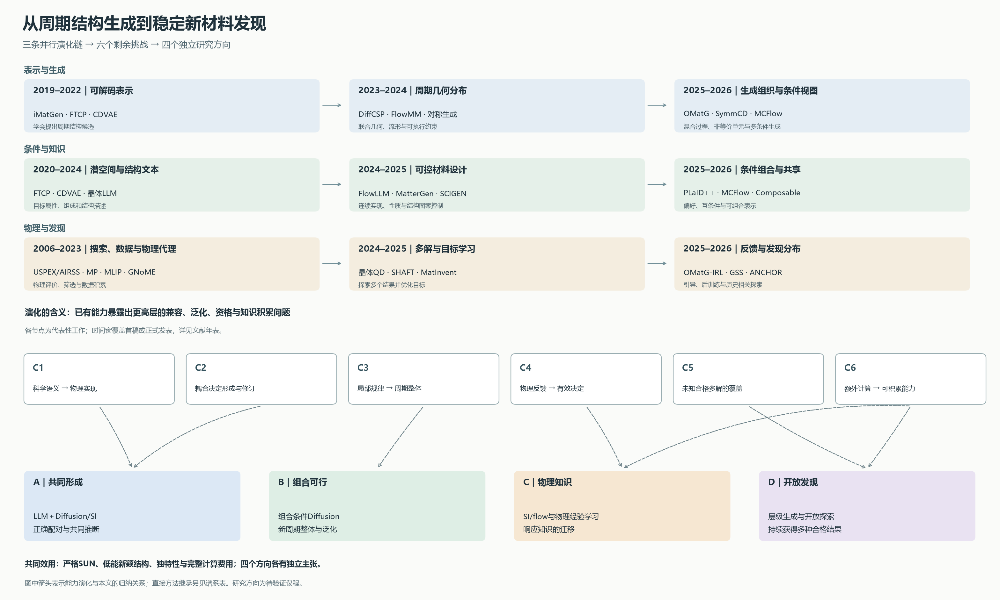

# 从生成周期结构到发现稳定新材料

## 晶体生成的能力演化、六个挑战与四条研究方向

[学术汇报（28页PPT及PDF）](presentation/README.md)

**摘要。** 晶体生成的目标正在从提出具有合理几何的周期结构，发展为在给定科学要求与计算预算下持续发现稳定、独特且新颖的材料。这一变化由三条相互交汇的研究线推动：可解码与物理一致的结构表示、越来越丰富的条件生成、以及物理评价与生成学习的结合。早期工作建立了从连续潜空间或结构图提出晶体的能力；周期扩散、流形flow和随机插值改进了联合分布建模；对称表示、晶体语言模型与多模态条件模型进一步扩大可表达的科学选择。通用原子间势、物理后训练和开放搜索则让评价结果参与下一次生成。与此同时，新的能力暴露出六类剩余问题：科学信息的物理实现、耦合决定的形成、局部知识的整体组合、反馈的可行动性、未知合格多解的覆盖，以及计算经验的知识积累。本文根据原始论文的方法和结果追溯这些问题，区分形式保证、任务内实证与仍开放的能力，并据此组织共同形成、组合可行、物理知识和开放发现四条独立研究方向。

资料范围截至2026年10月10日。早期工作用于解释关键转折，近期进展用于定位当前问题。日期区分首稿、正式发表与实质版本更新；图中的能力连线是综述归纳，直接方法继承另见[方法谱系](lineage.md)。四条方向属于研究议程，其新方法结果尚待实验建立。

*图1｜表示、条件和物理发现三条路线并行演化。已有进展留下六类相互联系的挑战；四条方向分别组织不同科学对象，不构成一套必须串联的系统。[矢量图](figures/evolution-map.svg) · [PDF图](figures/evolution-map.pdf)*

## 1. 我们研究的究竟是什么问题

研究对象是**可用于材料发现的生成分布**：模型需要提出元素、数量、周期位置和晶胞，使物理处理后的结构满足稳定资格，并带来不同于参考集合的有效材料。一个晶体可写为 $x=(N,A,F,L)$，物理处理得到 $y=\mathcal R(x)$。给定同一能量约定及竞争相参考，稳定性由候选与参考凸包的能量差判断；新颖性相对指定结构集合，唯一性则在一批最终结果中判断。

在本项目的严格口径下，稳定要求相对参考凸包的能量差 $m(y)\le0$。给定预算所产生的结果集合，研究希望增加其中不同的、稳定且参考新颖的物理结构。这样，单个候选的能量、原始结构之间的距离和最终发现数量有了明确分工：它们分别描述局部质量、表示差异与实际效用。

条件生成是同一问题的另一入口。条件可以指定组成、性质、空间群、局部结构图案或观测信息。模型需要学习 $p_\theta(x\mid c)$，而实际成功要求条件符合、物理资格与新颖性共同成立。一个结构满足输入标签之后，还要能在统一物理过程中保持有意义的实现。

| 任务 | 已给定什么 | 模型需要完成什么 | 科学成功如何判断 |
|---|---|---|---|
| 固定组成CSP | 元素与数量 | 晶胞、原子位置和可能的多晶型 | 低能结构、结构恢复或多晶型覆盖 |
| 无条件DNG | 基座先验及采样约定 | 化学与结构共同生成 | 稳定、独特、新颖结果及费用 |
| 性质条件生成 | 带隙、模量、密度等要求 | 满足目标的化学—结构组合 | 目标性质与物理资格的交集 |
| 对称／图案条件生成 | 空间群、位点或局部图案 | 全局兼容的周期结构 | 条件实现、稳定资格与有效变化 |
| 观测条件反演 | 衍射、图像或其它观测 | 与观测相容的结构候选 | 观测一致性及物理、结构证据 |

这些任务共享结构表示与生成工具，却有不同的已知信息和成功定义。因此，CSP匹配率、条件命中率和DNG的SUN分别提供证据，综述按任务解释它们。本文围绕57项去重的原始研究、必要背景与更正组织证据，覆盖2006–2026年的代表性转折。

## 2. 为什么这个问题重要而且有趣

材料功能来自化学、结构和物理条件的共同作用。同一组成可能具有不同配位或多晶型；类似局部环境可以构成不同周期整体。许多候选只有经过协同原子调整和晶胞变化，才会形成可接受的状态。生成模型的价值在于把已观察到的知识用于提出新的组合，降低在巨大空间中寻找有效结构的成本。

这个目标具有真实的规模意义。GNoME通过模型筛选、DFT计算和主动学习扩展候选空间；其更新凸包中包含约38.1万条新稳定结构。这是计算发现及知识积累的成果，同时说明竞争相参照会随着发现更新。[GNoME](https://www.nature.com/articles/s41586-023-06735-9)

生成能力还需要连接实验与功能。MatterGen将联合生成、性质控制和物理验证结合，SCIGEN从功能相关结构图案出发进行约束生成。它们说明模型可以围绕材料问题组织搜索，而不仅复现结构数据库的统计。[MatterGen](https://www.nature.com/articles/s41586-025-08628-5) · [SCIGEN正式版](https://www.nature.com/articles/s41563-025-02355-y)

对机器学习而言，晶体同时包含离散选择、连续几何、严格的等价关系、昂贵且部分可微的反馈，以及多个有效答案。这里的科学问题能够检验通用生成方法的核心能力：表示是否支持实际执行，局部规律能否组合，反馈能否形成迁移知识，以及优化能否保留多解。LLM、Diffusion和SI分别提供知识组织、分布生成和随机运输等工具，具体问题决定它们怎样组合。

### SUN在材料发现链中的位置

严格SUN是本研究的计算发现目标。热力学资格、局部动力学稳定、有限温度存在性和可合成性分别涉及不同证据。A-Lab把计算目标连接到实验流程，但其更正版也明确了物相识别及新颖性参照的重要性：当前报告为57个目标中36个成功，并区分了无法由衍射明确判断的情况。本文采用更正版，将实验闭环作为下游背景，不把它与生成模型SUN合并排名。[A-Lab](https://www.nature.com/articles/s41586-023-06734-w) · [2026作者更正](https://www.nature.com/articles/s41586-025-09992-y)

## 3. 为什么它很难：六个挑战之前的共同结构

**搜索空间兼有离散与连续组合。** 元素、数量、占位和结构关系决定哪些几何可能有意义；位置与晶胞又影响化学选择的合理性。单独处理一组变量会改变其它变量的条件分布。

**同一物理结构有多种表达。** 平移、旋转、原子排列和原胞选择都可能改变数据表示，而保持物理对象不变。表达冗余增加学习负担，也影响新颖性和重复的判断。

**物理可行性分为多个层次。** 周期坐标合法、指定对称性成立、没有严重碰撞、进入局部极小值、相对竞争相稳定，分别回答不同问题。模型可以在其中一层进步，而尚未获得下一层能力。

**数据反映观察和计算的选择。** 数据库包含被研究、被计算或被收录的材料；某些组成、对称族和物理条件有更多样本。拟合这种分布提供强先验，但发现需要进入数据较少的新区域，并识别哪些旧规律仍然成立。

**反馈依赖完整实现。** 高噪声或部分离散状态通常没有直接物理意义。可计算的完整结构能提供能量、力和应力，而这些信息要通过尚可改变的生成选择才能影响最终结果。

**成功具有集合性质。** 稳定性主要评估单个结果，独特性和发现效率涉及整个结果集合及探索历史。多个原始提案还可能经弛豫落到相同结果。生成分布、物理映射和评价参照共同决定最后的发现数量。

这些困难并非等待某个更大的网络统一消失。领域的发展正是逐步找到了针对不同层次的表示、学习和搜索方法。

## 4. 三条并行的演化链

### 4.1 从逐体系物理搜索到可学习的结构分布

USPEX和早期AIRSS为未知结构搜索提供了两类有力方法：通过进化算子组织候选，或从随机初始构型出发进行物理弛豫。它们在具体体系中找到了有竞争力的低能结构，也明确了一个长期困难——每次新材料搜索都要支付大量评价成本。[USPEX，2006](https://doi.org/10.1063/1.2210932) · [AIRSS早期实例，2006](https://doi.org/10.1103/PhysRevLett.97.045504)

Materials Project等数据资源让这些计算结果可以被系统复用；CGCNN等图模型进一步从局部环境学习整体性质。预测器因此能够帮助筛选候选，但完整结构仍需要被提出。生成建模将这个前向映射问题推进为逆向构造问题。[Materials Project，2013](https://doi.org/10.1063/1.4812323) · [CGCNN，2018](https://doi.org/10.1103/PhysRevLett.120.145301)

早期iMatGen与FTCP围绕可解码表示和性质引导探索这一方向。CDVAE将潜变量与周期去噪结合，使元素、晶格、原子数和坐标在可学习框架中组织起来。这一阶段的重要贡献是建立生成周期候选的途径，并形成后来反复使用的数据与任务定义。[CDVAE，2021首稿／ICLR 2022](https://arxiv.org/abs/2110.06197) · [早期表示文献](paper-catalog.md)

DiffCSP把固定组成下的晶格与分数坐标作为联合扩散对象，FlowMM采用流形flow matching，OMatG以随机插值组织连续几何并与离散元素过程耦合。它们分别改善物理等价关系、联合几何和生成过程的表达。SI涵盖多种流与扩散形式，因此演化的意义是方法空间的扩展，而非一种范式把另一种完全替代。[DiffCSP](https://arxiv.org/abs/2309.04475) · [FlowMM](https://arxiv.org/abs/2406.04713) · [OMatG](https://proceedings.mlr.press/v267/hollmer25a.html)

CrysBFN进一步把生成组织为对周期变量belief的更新，MCFlow则让不同模态具有独立信息进度。这些工作将问题从“采用哪条噪声路径”推进到“当前知道什么、还需要生成什么”。但是，联合分布可以被表示，与有限数据下学到正确的未见化学—几何关系，仍有不同的学习难度。[CrysBFN](https://arxiv.org/abs/2502.02016) · [MCFlow](https://proceedings.mlr.press/v306/seong26a.html)

### 4.2 从结构合法到科学条件的可执行实现

对称性研究提供了另一类进展。DiffCSP++、CrystalFormer、SymmCD、WyckoffDiff和Wyckoff Transformer将空间群、非等价位点或Wyckoff结构用于表示与生成。这些方法减少自由度，并在各自构造范围内实现指定几何关系。它们也改变了模型能直接作出的科学选择：生成器开始处理对称族、位点角色和结构配置，而不仅处理全部原子的原始坐标。[对称表示与方法年表](chronology.md)

保证的层次需要准确描述。例如，一个方法可以按指定对称操作展开有效的非等价位点；这并不替代对元素占位和相稳定性的学习。规范化表示与数据增强也各有作用：前者消除部分等价表达，后者帮助模型学习剩余等价关系。全链条的分布性质需要同时考虑先验、表示与生成过程。

LLM路线从CIF或结构化晶体语言学习化学与结构统计，随后出现两类连接：利用预训练语言知识生成结构，以及将语言模型的初始分布接到连续几何生成器。FlowLLM和CrysLLMGen展示了后者的实际价值，连续阶段通常保留离散化学选择，着重改善坐标与晶胞。这使高层知识与连续实现之间的接口成为可研究对象。[晶体语言模型](https://arxiv.org/abs/2307.04340) · [FlowLLM](https://arxiv.org/abs/2410.23405) · [CrysLLMGen](https://arxiv.org/abs/2510.23040)

条件生成也从潜空间中的目标引导，发展为多种科学要求的直接输入。MatterGen支持性质与化学等条件；SCIGEN让功能相关图案约束生成；PLaID++结合科学表示、偏好学习及条件任务；MCFlow用共享模型完成组成给定结构、结构给定元素和无条件生成。这里已经存在真实的可控生成能力，当前问题是条件之间的兼容、未见组合的泛化，以及最终物理资格。[MatterGen](https://www.nature.com/articles/s41586-025-08628-5) · [SCIGEN](https://www.nature.com/articles/s41563-025-02355-y) · [PLaID++](https://proceedings.mlr.press/v306/xu26l.html) · [MCFlow](https://proceedings.mlr.press/v306/seong26a.html)

近期的Composable Crystals、TFMat与UFO-MGen进一步探索局部concept、结构化文本以及离散配置—连续几何分工。它们将“科学描述怎样组织生成”推得更具体，同时暴露出新的解释问题：条件中究竟包含局部知识还是整胞模板？给定新配置能够完成，与自主提出可行新配置分别需要什么能力？[Composable Crystals](https://arxiv.org/html/2605.14769v2) · [TFMat](https://arxiv.org/html/2609.01076v2) · [UFO-MGen](https://arxiv.org/html/2609.26547v1)

### 4.3 从评价候选到学习物理反馈与发现分布

M3GNet和CHGNet把较广化学空间中的能量、力、应力及弛豫计算变得更可负担，使生成后的评价能够扩展为生成过程中的反馈。它们是物理工具，其覆盖和误差会随候选分布变化；反馈学习因此同时涉及选择什么结构和相信什么信息。[M3GNet](https://www.nature.com/articles/s43588-022-00349-3) · [CHGNet](https://www.nature.com/articles/s42256-023-00716-3)

让物理结果影响行动，早于近期生成模型后训练。RL-CSP学习结构搜索动作，GNoME将DFT结果回流到预测器。MatInvent、PLaID++和Chemeleon2把终点性质与物理资格用于更新生成分布；OMatG-IRL进一步将物理奖励用于连续生成场，OMatG-flash将相应学习推进到少步flow map。由此，反馈学入模型已成为领域的既有能力。[RL-CSP](https://pubs.rsc.org/en/content/articlehtml/2023/dd/d3dd00063j) · [MatInvent](https://arxiv.org/html/2511.03112v1) · [Chemeleon2](https://www.nature.com/articles/s42256-026-01262-4) · [OMatG-IRL](https://arxiv.org/html/2602.00424v2)

多解发现具有同样明确的先行。GFlowNet研究按奖励比例生成多个结果，晶体Quality-Diversity在性质空间保持多个低能候选，SHAFT利用层级对称选择组织探索。它们使分布和结果档案成为目标的一部分。近期ANCHOR将化学访问与结构生成分开，利用发现历史改变探索分配；它也显示结构语料的学习收益依赖来源与基座。[GFlowNet](https://jmlr.org/papers/v24/22-0364.html) · [晶体QD](https://arxiv.org/abs/2403.03511) · [SHAFT](https://doi.org/10.1039/D4DD00392F) · [ANCHOR](https://arxiv.org/html/2609.33407v2)

这一阶段留下的关键问题是知识与结果的关系：一次物理调用是修复一个样本、改变一个选择，还是形成了帮助下一批材料的规律？一个分布更新是提高已有成功的概率，还是使新的合格结构更容易被获得？这些问题将物理反馈、主动探索与生成学习连接起来。

## 5. 怎样理解已有研究的“解决”与主要结果

这里采用四种不同的证据层次。**构造保证**说明某些表示或约束按定义成立；**任务内实证**说明在指定数据与协议上性能改善；**迁移证据**说明能力用于未参与学习的条件或结构；**发现验证**说明候选通过了相应物理或实验检验。某项工作可以在多个层次有贡献。

| 方法家族 | 已有核心方法 | 已经建立的能力 | 仍需解释的连接 |
|---|---|---|---|
| 周期生成 | 去噪、流形flow、混合SI | 学习并生成周期化学—几何分布 | 新条件下正确配对及稳定实现 |
| 对称与结构语言 | 非等价位点、Wyckoff、规范化或结构序列 | 降低表达自由度，控制对称/配置 | 条件关系与最终物理资格 |
| 条件生成 | 条件扩散、性质适配、约束图案、多模态完成 | 多种目标的可控候选生成 | 条件兼容、稀疏条件与组合泛化 |
| 物理后训练 | 偏好、策略梯度、生成场对齐 | 反馈改变生成分布与部分终点指标 | 可迁移知识的内容与行动后果 |
| 多解搜索 | QD、GFlowNet、层级策略、历史相关探索 | 访问多个有用结果，改变化学搜索分配 | 未知合格类别的持续形成与保持 |

具体结果见[逐篇证据表](paper-catalog.md)和[关键结果与协议](results-and-protocols.md)。这些表保留任务、阈值、评价器、样本选择和分母。特别是，部分论文将 $E_{\mathrm{hull}}\le0.1$ eV/atom的结果称为SUN，另一些使用on-hull标准；部分工作由DFT评价，另一些使用MLIP。本文不把这些数值连接为跨论文排名。

从这些进展综合看，剩余困难集中在三个连接处：许多基础生成器从完整终态学习，却需要在部分信息下作决定；局部或单样本目标参与优化，而最终效用由物理处理后的结果集合决定；旧数据中有效的规律，还要在新的化学与结构背景中成立。多条件训练、物理后训练和主动学习已经分别改进这些连接，当前需要确定它们何时真正形成可迁移的发现能力。

评价本身也在演化。Structure Matches将单参考结构命中扩展到多晶型与集合恢复；LeMat-GenBench统一多个生成模型的评价；替换新颖性分析区分训练重复、替换可得与未匹配结构。它们让“模型改善了什么”成为更精确的问题。熟悉框架中的新稳定化学仍可以是有效发现，结构原型变化作为另一维度解释。[Structure Matches](https://arxiv.org/html/2509.12178v2) · [LeMat-GenBench](https://arxiv.org/html/2512.04562v2) · [替换分析](https://arxiv.org/html/2606.23166v1)

## 6. 六个挑战如何从这些进展中形成

六个挑战是围绕稳定新材料发现组织的残余问题，不是六个在某一年突然出现的全新主题。[挑战谱系表](challenge-genealogy.md)逐项列出代表性提出、已取得的进展、结果范围和当前缺口。

### C1．科学语义怎样变成正确物理结构

早期逆设计开始把性质要求映射到结构；晶体语言模型、空间群条件及结构图案控制又使输入具有更丰富的科学含义。如今可用条件越来越多，困难转向这些信息怎样在周期几何中共同实现。高层方案选择、条件传递和连续实现可以分别影响结果。由这条链自然产生A的共同形成问题，也支持B对科学关系可执行性的研究。

### C2．互相依赖的决定何时形成，何时修订

DiffCSP对晶格与坐标的联合建模、MatterGen/OMatG对化学与结构的联合生成，以及MCFlow的多模态条件路径，都已经处理了变量依赖。与此同时，组成先行再CSP的系统也有效。剩余问题是有限数据、模型容量和信息条件下，哪些决定可以先确定，哪些需要后续几何证据共同修订。A由此研究过程中的联合推断，而不仅比较固定生成顺序。

### C3．局部化学规律怎样组成新的周期整体

图性质模型和通用势学习了局部环境与物理量的关系；对称与concept生成使可复用结构单元进入生成表示。但是，晶体邻域共享原子、边和晶格，分别合理的环境仍可能在计数、周期连接或整体应变上冲突。B由此研究局部知识成立所需的共同条件，以及这些条件能否支持新的整体组合。

### C4．物理反馈怎样对应仍然有效的决定

物理搜索、RL动作、生成guidance和后训练都已显示作用。GSS等方法把生成先验与物理力结合，也把运行状态相关的指导列为进一步问题。今天需要理解的是，什么观测在什么生成状态下能帮助选择一项真正改变结果的行动。C由此研究物理可辨识性、剩余选择与完整后果之间的联系。[GSS](https://arxiv.org/html/2604.27636v2)

### C5．怎样保持并扩大未知的合格多解

多解搜索和奖励比例采样已有基础，难点进一步转向“合格”的定义和未知结果的形成。原始几何差异可能被弛豫消除，较高稳定率也可能伴随重复增长。D研究如何发现未知的合格结构、形成其生成概率并保持不同成功，而不是仅增加一般差异。

### C6．额外计算怎样积累成可迁移能力

主动学习、物理语料回流和后训练已经证明计算可以改善模型。剩余问题在于改善的知识究竟是什么：当前评分器校准、成功端点记忆、可复用的物理响应，还是选择新区域的能力？C关注经验如何进入跨条件的生成决定，D关注它如何推动持续发现并保持已有成功。这两个问题可以独立研究。

| 六个挑战 | 主要导出的方向 | 研究对象 |
|---|---|---|
| C1 语义到物理实现 | A，联系B | 科学关系与执行 |
| C2 耦合决定形成与修订 | A | 部分信息下的共同推断 |
| C3 局部规律到周期整体 | B | 可复用知识与全局兼容 |
| C4 反馈到有效决定 | C | 状态、行动与物理后果 |
| C5 未知合格多解 | D | 结果身份、资格与分布 |
| C6 计算到可积累能力 | C、D | 知识迁移与持续发现 |

## 7. 四个独立方向：逐一回答五个问题

### A．化学与几何的共同形成

**研究什么？** 研究科学知识、离散选择与逐渐形成的几何，怎样共同确定正确的化学—结构配对。

**为什么重要且有趣？** 一个生成器可以善于提出化学关系，另一个善于连续实现；如果两者能够交换有内容的信息，就可能在未见组合上共同改进。这连接知识组织、近似推断和物理实现。

**为什么难？** 部分几何可能仍含错误，离散选择一旦过早确定会限制后续实现，而内生生成的信息也可能只强化原假设。模型需要识别哪些关系可依赖、哪些选择仍应保持开放。

**已有研究为什么还没有完全解决？** LLM加连续精修已经有效，纯联合生成也已存在。当前缺少的是在有限学习条件下解释并建立：双向共同形成何时比强分阶段模型更有效，知识来源和几何证据分别贡献什么。

**核心方法与结果是什么？** 优先研究LLM＋Diffusion/SI的双向协同：结构化科学状态组织关系选择，周期连续模型生成多解几何，中间证据支持修订。纯混合离散—连续SI保留为竞争路线。应建立的主要结果是新组合上更可靠的配对、可解释的有效修订，以及独立DNG的SUN增量；目前这些属于研究命题。[方向A](../programs/a-coformation.md)

### B．可组合化学知识与整体物理可行性

**研究什么？** 研究已有局部规律需要什么共享背景，才能形成新的周期结构和稳定化学组合。

**为什么重要且有趣？** 数据库很难枚举完整材料空间，局部环境与关系却可能被多种材料共享。可组合知识提供一种超越完整结构记忆的能力来源。

**为什么难？** 周期邻域不是独立部件；原子、键和晶格被共同使用。几何可嵌入之后，电子环境、整体应变与相竞争仍影响稳定性。

**已有研究为什么还没有完全解决？** concept、对称配置和条件完成已有成果，但收益可能来自局部规律、整胞模板或后续物理重组织。需要识别知识复用的实际条件与迁移范围。

**核心方法与结果是什么？** 优先研究带显式周期关系的组合条件Diffusion，学习重叠要求在统一位置—晶胞空间中的多解实现；LLM可组织可检查的科学关系。应建立的结果是跨化学、连接或原胞复杂度的稳定组合泛化，以及说明何种全局条件帮助了迁移的机制证据。[方向B](../programs/b-compositional-feasibility.md)

### C．物理反馈与可积累生成知识

**研究什么？** 研究物理观测何时帮助有效决定，以及条件变化、补偿和重组的经验怎样用于新的生成请求。

**为什么重要且有趣？** 物理计算昂贵，但一次计算包含的关系可能帮助多个材料。把这种关系学入模型，能够让计算投入逐渐形成生成能力。

**为什么难？** 物理观测发生在可计算结构上，生成过程包含不完整状态；动作效果还依赖后续演化。数值优化轨迹、终点资格与可迁移物理关系需要分别理解。

**已有研究为什么还没有完全解决？** 后训练、引导和数据回流已经证明反馈有用。新的缺口是哪些响应内容在新化学与不同续程中仍有价值，以及它如何超出相同终点池的普通训练或标量奖励学习。

**核心方法与结果是什么？** 优先研究SI/flow的分布与路径学习，保留来源、实际变化、响应及多种终点的关系，并通过共享生成场学习可迁移实现。LLM/AR科学决策与连续生成是另一条路线。应建立的结果是相同物理投入下的知识迁移和后续独立生成收益。[方向C](../programs/c-physics-to-knowledge.md)

### D．开放多解发现与生成分布的增长

**研究什么？** 研究未知的合格结果怎样被发现、学入分布、持续保持可获得，并帮助进一步发现。

**为什么重要且有趣？** 材料发现需要多个不同的有效答案，且合格类别难以事先列完。研究对象因此是一个不断增长的结果分布，而非单个最高分样本。

**为什么难？** 物理评价才确认资格与身份，探索历史改变重复采样的价值；稳定性优化、覆盖和已有成功的保持可能互相牵制。

**已有研究为什么还没有完全解决？** QD、GFlowNet、组成搜索与集合奖励已能获得多种结果。当前还需要连接未知物理资格、真实结果身份、结构分支和持续学习，解释概率重分配与新能力形成的区别。

**核心方法与结果是什么？** 优先研究层级LLM/AR＋条件Diffusion及开放探索，让上层组织科学选择、下层保留多种实现，以物理结果与发现历史更新分布。可以固定低层独立研究探索，也可研究联合学习。应建立的结果是同预算下更多首次发现、学到的新成功保持可得，以及未用于更新的进一步发现。[方向D](../programs/d-open-successful-discovery.md)

## 8. 本综述的主要结论与研究组织

第一，晶体生成的发展是能力的叠加与重新分工。周期表示、对称构造、科学条件、物理反馈和多解搜索分别解决不同困难；LLM、Diffusion和SI是可组合的技术范式。

第二，已有研究已经提供实质成果。六个挑战应定位在这些成果留下的兼容、泛化和知识问题上。一个领域综述的价值在于说明新问题为何在已有能力之后变得重要，而不仅罗列方法仍有哪些不足。

第三，科学对象决定技术贡献的含义。正确关系的共同形成、局部知识的全局成立条件、可迁移物理响应和未知合格分布，分别提供四个独立的学习对象。具体网络、损失和模型应服务于这些对象。

第四，发现能力需要一致的结果语言。条件正确、几何合法、低能、on-hull、参考新颖与实验实现分别标注，比较还要保留真实请求、未知状态和完整费用。这样才能判断一个方法增长了哪种能力。

四条方向共享严格SUN目标与必要的物理基础，各自保持独立中心。已有项目实验提供选题线索，新的科学主张由各方向的独立结果建立。本文的主要成果是可追溯的演化链、挑战谱系和研究议程；新算法的性能结果尚待建立。

## 阅读与证据索引

- [文献年表](chronology.md)：首稿、正式发表与能力转折。
- [方法谱系](lineage.md)：直接继承、比较关系与本文概念综合。
- [六挑战谱系](challenge-genealogy.md)：每项挑战的提出、进展、残余问题与方向对应。
- [关键结果与协议](results-and-protocols.md)：代表结果及其适用范围。
- [逐篇问题—方法—结果目录](paper-catalog.md)：各篇工作分别回答五个问题。
- [结构化来源](references.json) · [参考文献BibTeX](references.bib)。
